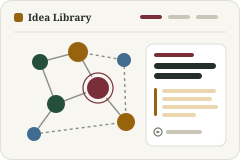

  

# Idea Library

  

Didn't work? Create a Studio workspace and paste this to your agent:
` /use-template https://github.com/AutogenousEngine/idea-library`

## Why you care

Years of notes, essays and recorded conversations hold the ideas you keep coming
back to, but they are scattered and you can't see how they connect. Idea Library
pulls those ideas out in your own words, with every quote checked against what
you actually said or wrote. You get a library you can read and explore, and
every claim traces back to its source.

## How to use it

1. **Build your library.** The app starts empty and says "No library yet" until
   you do. Ask your agent to "build my idea library". It asks
   for your name as it appears on recordings, anything to keep private, and
   where your material is:
   - files you drop in (markdown, text, HTML, PDF, captions, transcript exports, audio)
   - a Substack, by name
   - Plaud or Otter.ai recordings, through each platform's official sign-in
2. **See the cost first.** Before any model call, it shows an estimate on the
   default model (`claude-sonnet-5-5`) and asks before a large run. Haiku is
   offered as a much cheaper option.
3. **Browse it** in the Idea Library app:
   - **Reading page**: your ideas in chapters drawn from your material, the
     threads that connect them, and every source.
   - **Graph**: every idea and link at once, as a flat graph or a sphere, in light or dark.
   - **Idea map**: follow a connection to see why it exists. Links you stated are
     marked apart from suggested ones, and each quote opens its source: the
     original link, the full transcript, or the audio.
   - **Classic view**: a searchable list with a shortlist and content-format filters.
4. **Add more later.** Drop in new files or fetch new recordings and run it
   again. Only new or changed material reaches the model, and your hand edits
   are kept.

The library is plain JSON in `data/.apps/idea-library/`, so you can read it,
edit it, or check it (`run.py validate`).

## Ideas for making it yours

- Add a fetcher for another source you write in, such as a blog's RSS feed,
  a Notion export, or a folder of journal entries.
- Run the build as a weekly routine, so new recordings land in the library
  without you asking.
- Use each idea's essay seed and suggested formats to draft a Substack note
  or a short video script straight from the map.
- Restyle the reading page to match your own site, and publish it as a
  public "what I think" page.
- Add a timeline view that shows when each idea first appeared, using the
  dates your sources already carry.

## What this is

This repository is a published **Imbue Studio template**: a clean, bootable
snapshot of what an agent built, ready to adapt into your own. It is NOT the
generic workspace template -- it is this specific project.

[`template.md`](template.md) is the full manifest -- what it is, how it
works, what it needs to run, and what to adapt -- with the
machine-readable half (recipe, requirements, and the environment it needs
installed) in [`template.toml`](template.toml).

## License

The Idea Library app (`system/apps/idea-library/`) and its library builder
(`.agents/skills/build-idea-library/`) are released under the
[MIT License](system/apps/idea-library/LICENSE).

The rest of this repository is the Imbue Studio workspace it runs in, copyright
Imbue, under the
[Fair Core License 1.0, MIT Future License (FCL-1.0-MIT)](system/apps/system_interface/LICENSE).
In short: you may use, change and share it for any purpose except a competing
commercial product or service, and each version becomes MIT-licensed two years
after Imbue released it. Third-party material in the tree keeps its own
license: see [`THIRD_PARTY_NOTICES.md`](THIRD_PARTY_NOTICES.md) and the
`LICENSE` file in each directory that has one.
